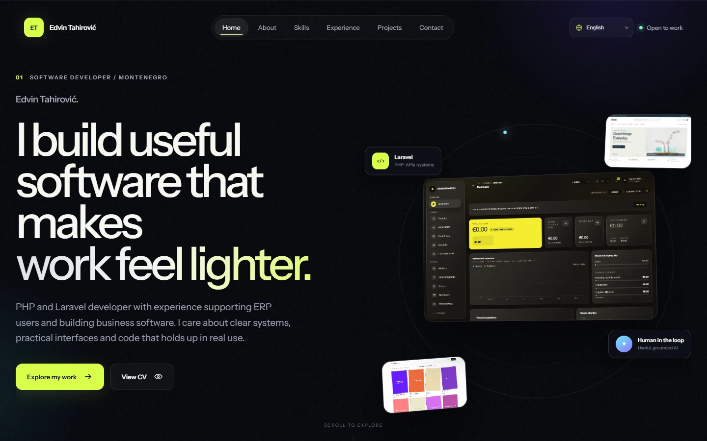

# Edvin Tahirović

### Software Developer Portfolio

A premium, data-driven portfolio presenting real business systems, commerce platforms and practical AI work.

## Overview

This is a fully static portfolio built with HTML5, CSS3, vanilla JavaScript and JSON. It requires no framework, server, database or build process, and is ready to deploy directly through GitHub Pages.

The experience includes:

- A cinematic, responsive homepage with custom motion and 3D interface previews
- Selected project presentations driven by reusable JSON data
- Real screenshots from locally executed applications
- Full English, Turkish and Serbian localization
- Accessible navigation, keyboard support and reduced-motion handling
- Downloadable-free CV viewing in a separate browser tab
- Relative paths for root-domain and project-subpath hosting

